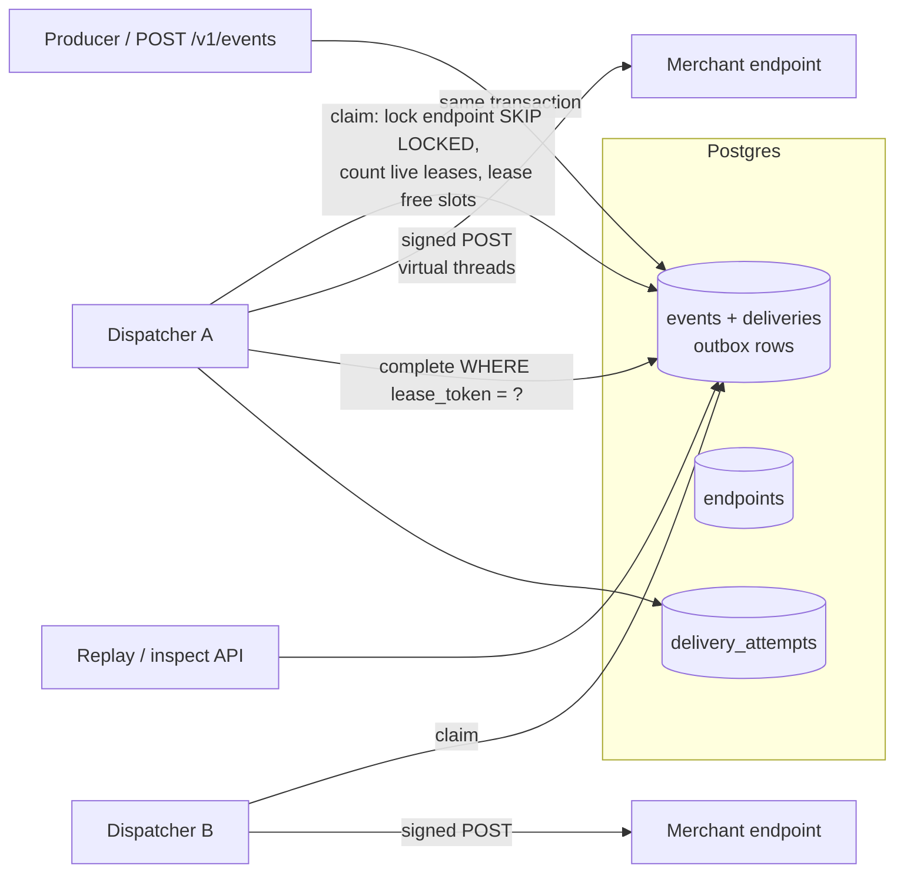
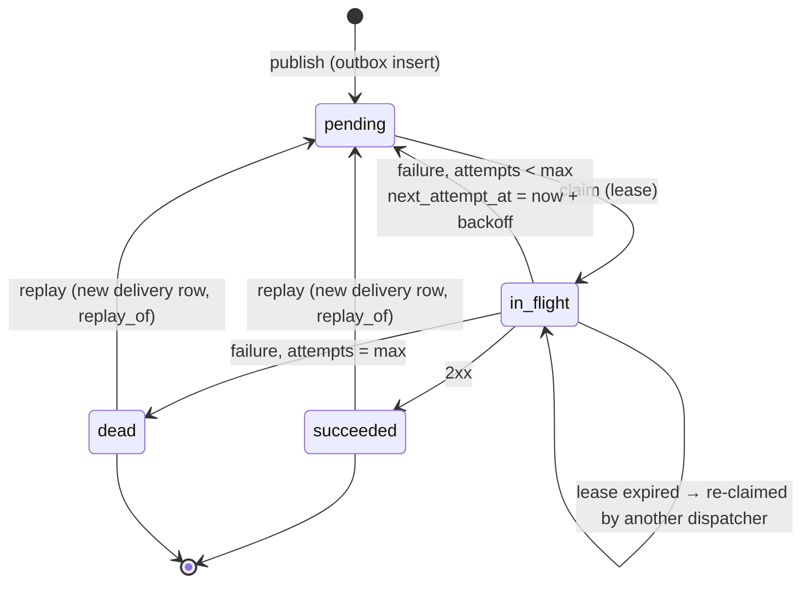

# webhook-delivery

[](https://github.com/anirudhpundhir/webhook-delivery/actions/workflows/ci.yml)

A webhook dispatch service in Java 21 / Spring Boot 3.5 on Postgres. It sends **Stripe-style signed payloads** with a **transactional outbox**, at-least-once delivery with **exponential backoff + jitter**, a **dead-letter** state with a **replay API**, and **per-endpoint concurrency limits that hold across any number of dispatcher instances**.

- **No dual writes**: events and their delivery rows commit in the producer's own transaction.
- **Correct under multiple instances**: claims use `FOR UPDATE SKIP LOCKED` plus endpoint-row locking and lease counting. Completions are fenced by a lease token, so a zombie worker can't clobber a re-claimed delivery.
- **Signatures**: `t=…,v1=HMAC-SHA256(secret, t.body)`, signed at send time. A verifier with tolerance checking, constant-time compare and rotation support is included.
- **Operable**: a full attempt log per delivery, dead-letter listing, single and bulk replay, and graceful shutdown that drains in-flight requests.

## Architecture





Layout:

```
src/main/java/.../signing/     WebhookSignature: sign + verify (tolerance, rotation, constant-time)
src/main/java/.../event/       EventPublisher (outbox write, MANDATORY tx), POST /v1/events
src/main/java/.../endpoint/    endpoint registration / update API
src/main/java/.../delivery/    DeliveryRepository (claim, complete, replay), Dispatcher, HttpSender, Backoff, API
src/main/resources/db/migration/V1__schema.sql
src/test/java/...              unit tests, Postgres integration tests, tagged benchmark
docs/DESIGN.md                 ADRs: outbox, leasing + limits, fencing, backoff, signatures, replay
```

## Quick start

```bash
createdb webhooks                      # Postgres 17 at localhost:5432 (postgres/postgres)
make run                               # or: DATABASE_URL=jdbc:postgresql://host/db make run
```

These are real responses from a local run (receiver: a 10-line Python HTTP server on :9999):

```console
$ curl -s -XPOST localhost:8080/v1/endpoints -H 'Content-Type: application/json' \
    -d '{"url":"http://127.0.0.1:9999/hooks","maxConcurrency":5,"eventTypes":["payment.succeeded"]}'
{"id":"d87593c0-…","url":"http://127.0.0.1:9999/hooks","secret":"whsec_dxNf…","eventTypes":["payment.succeeded"],"maxConcurrency":5,"enabled":true,…}

$ curl -s -XPOST localhost:8080/v1/events -H 'Content-Type: application/json' \
    -d '{"type":"payment.succeeded","data":{"amount":1999,"currency":"usd"}}'
{"eventId":"b272a9bb-…","deliveries":1}
```

What the receiver got:

```
Webhook-Id: b272a9bb-331f-4863-b7b4-526bdc3296c0
Webhook-Signature: t=1792190624,v1=0237f17b71302bb30ee3e8691aafc66dd78041d68fc108536a9ebc1717728eee
{"id":"b272a9bb-…","type":"payment.succeeded","created_at":"2026-10-16T22:43:44.481Z","data":{"amount":1999,"currency":"usd"}}
```

Inspect and replay:

```console
$ curl -s localhost:8080/v1/deliveries/b20a20d0-…
{"status":"succeeded","attempts":1,"lastStatusCode":200,…,"attemptLog":[{"attempt":1,"durationMs":39,"statusCode":200}]}
$ curl -s -XPOST localhost:8080/v1/deliveries/b20a20d0-…/replay
{"delivery_id":"2a6ef32b-…"}
$ curl -s 'localhost:8080/v1/deliveries?status=dead&endpointId=…'      # dead-letter queue
$ curl -s -XPOST 'localhost:8080/v1/endpoints/…/replay-dead?since=2026-10-01T00:00:00Z'
```

### Verifying on the receiver

```java
WebhookSignature.verify(request.getHeader("Webhook-Signature"), rawBody,
        List.of(currentSecret, previousSecret), Duration.ofMinutes(5), Clock.systemUTC());
// then dedupe on Webhook-Id (delivery is at-least-once)
```

## Configuration (`webhooks.*`)

| Property | Default | Meaning |
|---|---|---|
| `dispatcher-enabled` | `true` | run a dispatcher in this process (set `false` on API-only nodes) |
| `poll-interval` | `200ms` | idle poll interval; dispatchers re-poll immediately while there is work and capacity |
| `claim-batch-size` / `max-in-flight` | `100` / `256` | per-instance claim size and concurrent request cap |
| `lease` | `30s` | must exceed `request-timeout + connect-timeout` (validated at startup) |
| `max-attempts` | `16` | then `dead` |
| `backoff-base` / `backoff-cap` | `30s` / `6h` | retries span 19–38h with the defaults |

## Testing

```bash
make test        # 23 tests: unit + integration against $TEST_DB (default jdbc:postgresql://localhost:5432/webhooks_test)
```

The integration tests cover delivery with signature verification, event-type routing and disabled endpoints, outbox rollback, retry until success with backoff gaps asserted, dead-letter after max attempts followed by replay (idempotent), bulk dead-letter replay, 409 on replaying an unfinished delivery, **the per-endpoint limit across two dispatcher instances with no starvation of a neighbour**, **lease expiry redelivery plus a fenced stale completion**, **8 concurrent claimers with no double claims**, validation, and graceful shutdown. Two single-line mutants were checked by hand: dropping the slot count, and dropping the lease-token fence. Each makes its test fail.

## Benchmarks

`make bench` runs `DispatchBenchmark`. It pre-loads 20,000 deliveries (10 endpoints, `max_concurrency=64`), then measures wall time until all of them have succeeded. Each delivery is claim → signed POST to an in-process receiver → completion transaction. Measured on the build box: **8 vCPU Intel Xeon (virtualized), 15 GiB RAM, Linux, OpenJDK 21.0.12, Postgres 17.11 on the same host (default config), receiver in the same JVM**. Two runs:

| Dispatchers (same JVM) | Receiver latency | Run 1 | Run 2 |
|---:|---:|---:|---:|
| 1 | 0 ms | 4,846/s | 5,285/s |
| 2 | 0 ms | 8,348/s | 8,707/s |
| 1 | 20 ms | 5,879/s | 6,230/s |
| 2 | 20 ms | 8,334/s | 7,506/s |

With a 20ms receiver, every endpoint's observed max concurrency was exactly 64, which is its limit. These are single-box numbers: the database, the dispatcher and the receiver all share the same 8 vCPUs, and runs are only a few seconds long.

## License

MIT
